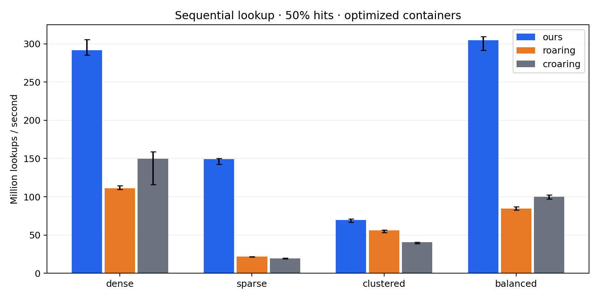
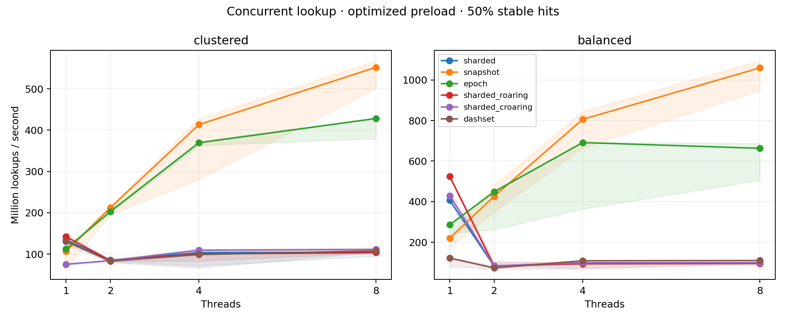

# External comparison results

Generated from individual trials by `scripts/report_comparison.py`. Throughput is millions of operations per second; ranges are the observed minimum and maximum across trials.

## Baseline B: sequential lookup, 50% hits

| Dataset | Ours Mops/s | roaring Mops/s | croaring Mops/s | vs roaring | vs croaring |
|---|---:|---:|---:|---:|---:|
| dense | 291.38 | 111.10 | 149.89 | 2.62× | 1.94× |
| sparse | 149.12 | 21.97 | 19.39 | 6.79× | 7.69× |
| clustered | 69.47 | 56.31 | 40.51 | 1.23× | 1.71× |
| balanced | 304.76 | 84.51 | 100.14 | 3.61× | 3.04× |

## Baseline C: concurrent pure reads, 8 threads

| Dataset | sharded | snapshot | epoch | sharded roaring | sharded croaring | DashSet |
|---|---:|---:|---:|---:|---:|---:|
| dense | 73.83 | 982.08 | 640.97 | 69.04 | 71.13 | 113.97 |
| sparse | 100.86 | 187.64 | 192.04 | 87.26 | 88.52 | 110.06 |
| clustered | 104.59 | 552.03 | 428.12 | 103.43 | 111.37 | 107.80 |
| balanced | 98.58 | 1059.50 | 662.96 | 95.16 | 98.77 | 110.10 |

The full [summary CSV](benchmark-results/summary.csv) includes all wins and losses, unoptimized reads, all hit ratios, build, optimize, removal, set overlap/cardinality ratios, and concurrent mixes. Individual trials are archived alongside it. See [methodology and interpretation](external-benchmarks.md) before using a number in a resume.

## Process memory

The [memory summary](benchmark-results/memory-summary.csv) reports RSS, paired empty-process RSS differences, trial ranges, and peak RSS. These include allocator retention and construction effects; they are not exact heap sizes. See the raw memory CSV for cardinalities and copy counts.

| Dataset | Ours RSS MiB | roaring RSS MiB | croaring RSS MiB |
|---|---:|---:|---:|
| dense | 5.78 | 5.72 | 5.83 |
| sparse | 12.16 | 13.30 | 12.48 |
| clustered | 7.64 | 7.69 | 8.36 |
| balanced | 10.89 | 10.36 | 12.06 |

RSS table: one live optimized map per process, before subtracting the empty-process control. The linked CSV includes paired differences and all concurrent wrappers.
